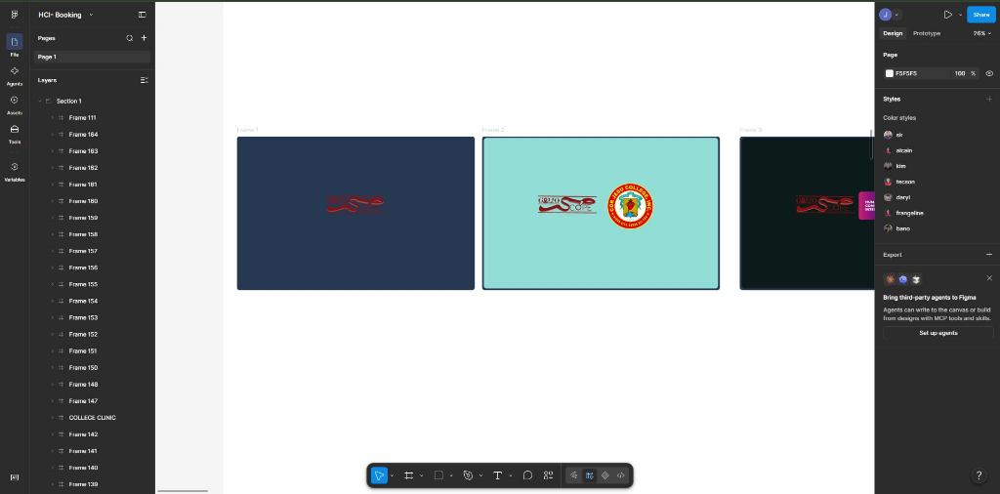
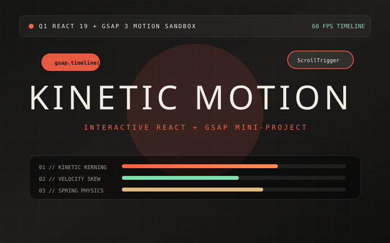

# Julios Gabriel Dumagan — Creative Developer Portfolio

> **Live URL:** [juliosdumagan-portfolio.vercel.app](https://juliosdumagan-portfolio.vercel.app)  
> **GitHub Repository:** [github.com/jblr234/juliosdumagan-portfolio](https://github.com/jblr234/juliosdumagan-portfolio)  
> **Author:** Julios Gabriel Dumagan — BSIT Student at **Cor Jesu College (CJC)**, Digos City, Philippines  

---

## 📸 Portfolio Screenshots & Previews

### Project 01 — GALIOSCOPE (Cor Jesu College Campus Facilities Booking Prototype)


### Project 03 — Kinetic Resonance (Q1 React 19 & GSAP 3 Motion Lab)


---

## ✦ Description

An editorial, motion-driven creative developer portfolio built for **Julios Gabriel Dumagan**, a Bachelor of Science in Information Technology (BSIT) student at **Cor Jesu College** in Digos City, Philippines.

> *“I build systems that see, and interfaces that explain what they see.”*

Key highlights of this portfolio:
- **Explosive Radial Hero & Cursor Proximity Physics:** 10 multi-depth 3D floating objects with `gsap.quickTo` parallax and cursor repulsion physics.
- **GSAP ScrollSmoother & ScrollTrigger Choreography:** Inertial smooth scrolling (`smooth: 1.35`, `effects: true`) and 3-phase scrubbed section reveals.
- **Interactive Project Showcase:**
  1. **GALIOSCOPE — Campus Facilities Booking:** 60+ frame Human-Computer Interaction (HCI) Figma prototype for Cor Jesu College facilities.
  2. **2D Frame-by-Frame Animation — Krita:** Final project animated short film for *IT Professional Elective 3 (Digital Drawing)* with an inline playable HTML5 video player.
  3. **Kinetic Resonance — Q1 React & GSAP Lab:** Interactive React 19 + GSAP 3 motion and Web Audio synthesizer mini-project.
- **Validated Contact Brief & Direct Channels:** Real-time form validation, celebratory confetti burst, and direct links to Email (`juliosdumagan@g.cjc.edu.ph`), GitHub (`@jblr234`), and LinkedIn.

---

## 🛠 Tech Stack

| Category | Technologies |
| :--- | :--- |
| **Frontend & UI** | React 19, Vite, Tailwind CSS 3.4, React Router DOM 7, Lucide Icons |
| **Motion & Physics** | GSAP 3 (`ScrollTrigger`, `ScrollSmoother`, `@gsap/react`) |
| **AI & Vision** | Python, YOLOv8, ByteTrack, OpenCV |
| **Web & Backend** | Flask, SQLite |
| **Creative & Design** | Figma (Interactive Prototyping), Krita (2D Frame-by-Frame Animation), Unity, Vuforia |

---

## 💻 Setup Instructions (Run Locally)

### 1. Clone the Repository
```bash
git clone https://github.com/jblr234/juliosdumagan-portfolio.git
cd juliosdumagan-portfolio
```

### 2. Install Dependencies
```bash
npm install
```

### 3. Start the Local Development Server
```bash
npm run dev
```
Open **`http://localhost:5173`** in your browser.

### 4. Build for Production
```bash
npm run build
```

---

## 👤 Author & Links

- **Name:** Julios Gabriel Dumagan (BSIT Student • Cor Jesu College)
- **Email:** [juliosdumagan@g.cjc.edu.ph](mailto:juliosdumagan@g.cjc.edu.ph)
- **GitHub:** [github.com/jblr234](https://github.com/jblr234)
- **LinkedIn:** [linkedin.com/in/julios-gabriel-dumagan-138067447](https://www.linkedin.com/in/julios-gabriel-dumagan-138067447/)
